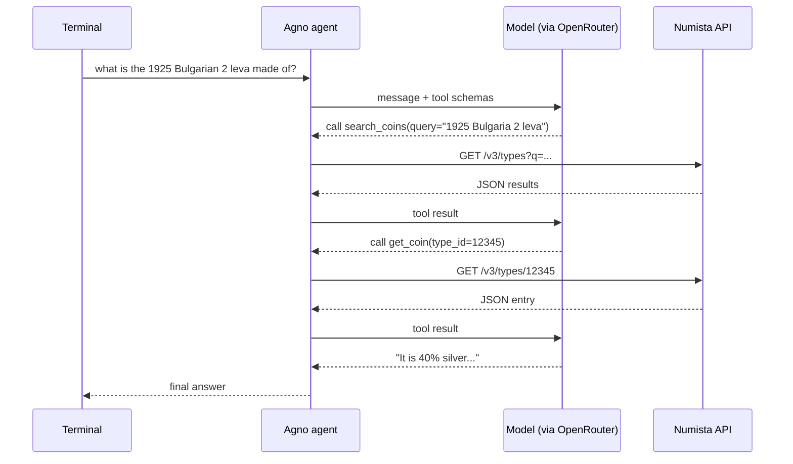

A **Large Language Model** on its own can only produce text. It cannot check today's exchange rate, read your database or call an API, because it has no connection to anything outside the conversation. An **agent** is the piece that closes that gap: it hands the model a set of functions it may call, runs whichever one the model asks for, and feeds the result back so the model can answer with real data.

[**Agno**](https://github.com/agno-agi/agno){:target="_blank"} is a Python framework for building exactly that. In this article we will build a working agent in a single file: a model served through _OpenRouter_, two custom tools that query a public _REST API_, and conversation history persisted to _SQLite_. In a follow-up article we will take the same agent and expose it over _HTTP_.

The agent we end up with answers questions about coins and banknotes by querying the [Numista](https://en.numista.com){:target="_blank"} catalogue.

## Requirements

- _Python 3.12+_
- [uv](https://docs.astral.sh/uv/){:target="_blank"}, for dependency management
- An [OpenRouter](https://openrouter.ai){:target="_blank"} API key
- A [Numista](https://en.numista.com){:target="_blank"} API key, for the tools

## Project setup

Create the project and add the dependencies:

```bash
uv init agno-example
cd agno-example
uv add agno openai requests python-dotenv
```

_Agno_ does not bundle model providers, so `openai` is needed even though we are not using _OpenAI_ — the _OpenRouter_ integration speaks the _OpenAI_ API format. `requests` is for our own tools, and `python-dotenv` keeps the keys out of the source.

Create a `.env` file in the project root:

```ini
OPENROUTER_API_KEY=sk-or-v1-...
NUMISTA_API_KEY=<your Numista API key>
```

Add `.env` to `.gitignore` before the first commit.

## Choosing a model

_OpenRouter_ is a single gateway in front of most of the commercial and open models, which means one API key and one line to switch between them:

```python
from agno.models.openrouter import OpenRouter

model = OpenRouter(id="nvidia/nemotron-3-ultra-550b-a55b:free", max_tokens=4096)
```

The `:free` suffix matters. Models with that suffix are usable without buying credits, limited to 50 requests a day. A paid model is the same line with a different `id`:

```python
model = OpenRouter(id="deepseek/deepseek-v4.1-flash-1017", max_tokens=4096)
```

There is one constraint that is easy to miss: **not every model supports tool calling**. A model without it will simply answer from its training data and never call your functions, which looks like a bug in your code rather than a limitation of the model. Check `supported_parameters` on the model's _OpenRouter_ page and look for `tools` before swapping one in.

## Writing the tools

A tool in _Agno_ is a plain Python function. There is no base class to extend and no decorator to apply. What makes a function usable as a tool is its **signature and its docstring**, because that is what gets converted into the schema the model sees.

First, a small helper for the _HTTP_ calls:

```python
import os

import requests
from dotenv import load_dotenv

load_dotenv()

NUMISTA_API = "https://api.numista.com/v3"
CATALOGUE_URL = "https://en.numista.com/catalogue/pieces{}.html"


def _numista(path: str, params: dict | None = None) -> dict:
    key = os.getenv("NUMISTA_API_KEY")
    if not key:
        raise RuntimeError("NUMISTA_API_KEY is not set; see the README.")
    response = requests.get(
        NUMISTA_API + path,
        params={"lang": "en", **(params or {})},
        headers={"Numista-API-Key": key},
        timeout=10,
    )
    response.raise_for_status()
    return response.json()
```

The leading underscore is a hint to the reader, not to _Agno_ — a function only becomes a tool when you register it, which we will do below. `_numista` stays private because the model has no business calling it directly.

Now the two tools. The first searches the catalogue:

```python
def search_coins(query: str) -> str:
    """Search the Numista catalogue for coins and banknotes.

    Args:
        query: Coin or banknote name, country or denomination, for example
            "2 leva 1925" or "Bulgarian stotinka".
    """
    data = _numista("/types", {"q": query.strip(), "count": 20})
    types = data.get("types", [])
    if not types:
        return "No matching coins found."
    return "\n".join(
        f"- [{t['id']}] {t.get('title', '?')}"
        f" ({t.get('issuer', {}).get('name', '?')},"
        f" {t.get('min_year', '?')}-{t.get('max_year', '?')})"
        for t in types
    )
```

The second fetches one full entry:

```python
def get_coin(type_id: int) -> str:
    """Return the full catalogue entry for one coin or banknote.

    Args:
        type_id: Numista type id, as returned by search_coins.
    """
    coin = _numista(f"/types/{type_id}")
    fields = [
        coin.get("title", "?"),
        CATALOGUE_URL.format(type_id),
        f"Issuer: {coin.get('issuer', {}).get('name', '?')}",
        f"Years: {coin.get('min_year', '?')}-{coin.get('max_year', '?')}",
        f"Composition: {coin.get('composition', {}).get('text', '?')}",
        f"Weight: {coin.get('weight', '?')} g",
        f"Diameter: {coin.get('size', '?')} mm",
        f"Obverse: {coin.get('obverse', {}).get('description', '')}",
        f"Reverse: {coin.get('reverse', {}).get('description', '')}",
    ]
    return "\n".join(fields)[:4000]
```

Three details in these functions are worth dwelling on, because they are the difference between a tool that works and one that quietly misbehaves.

**The docstring is a prompt.** It is not documentation for your colleagues, it is the text the model reads when deciding whether to call the function and what to pass. `query: Coin or banknote name, country or denomination, for example "2 leva 1925"` tells the model to send a search term. Without that example, a model will happily pass a full sentence — _"I would like to know about the 1925 two leva coin"_ — and the search returns nothing.

**The two tools are designed to chain.** `search_coins` returns `[12345] Title` rather than a prettier format, and `get_coin` takes a `type_id`. The model reads the id out of the first result and passes it to the second without being told to. If `search_coins` returned only titles, the model would have nothing to hand over and would be stuck.

**The return value is also a prompt.** Whatever the function returns goes straight back into the model's context as text, so `"No matching coins found."` is better than returning an empty string or raising — the model can tell the user what happened. For the same reason `get_coin` truncates at 4000 characters: a tool that returns an entire page of _JSON_ burns through the context window and, on a small model, drowns the actual question.

The `.get()` chains with `'?'` fallbacks are defensive on purpose. Catalogue entries vary in completeness, and a missing `weight` field should produce `Weight: ? g` rather than a `KeyError` that kills the whole turn.

## Assembling the agent

```python
from agno.agent import Agent
from agno.db.sqlite import SqliteDb

agent = Agent(
    id="1",
    name="Sergio",
    model=OpenRouter(id="nvidia/nemotron-3-ultra-550b-a55b:free", max_tokens=4096),
    instructions=(
        "You are Sergio, a numismatics assistant. Use the Numista catalogue "
        "tools to answer questions about coins and banknotes. Search first, "
        "then fetch the full entry for the type id that best matches."
    ),
    add_history_to_context=True,
    db=SqliteDb(db_file="agent.db"),
    tools=[search_coins, get_coin],
)
```

- **`instructions`** is the system prompt. Note that it does more than set a persona: it describes the intended tool order. Models are inconsistent about chaining two tools on their own, and one sentence of guidance is far more reliable than hoping they work it out.
- **`add_history_to_context=True`** replays earlier turns, so _"and how much does it weigh?"_ resolves against the coin discussed a moment ago. Without it every message arrives with no past.
- **`db=SqliteDb(...)`** writes the conversation to `agent.db`, created on first run.
- **`tools=[...]`** is the registration step, and it holds **references** to the functions. They must therefore be defined *above* the `Agent(...)` call — a function defined further down the file raises `NameError` at import time.

If you need to see what is actually being sent to the model, add `debug_mode=True`. _Agno_ calls the parameter `debug_mode`, not `verbose`.

## Running it

A terminal loop is enough to use the agent:

```python
if __name__ == "__main__":
    try:
        while prompt := input("Ask something: "):
            agent.print_response(prompt)
    except (EOFError, KeyboardInterrupt):
        pass
```

```bash
uv run agent.py
```

```
Ask something: what is the 1925 Bulgarian 2 leva made of?
```

The walrus operator makes an empty line exit, and catching `EOFError` and `KeyboardInterrupt` means `Ctrl-D` and `Ctrl-C` quit cleanly instead of dumping a traceback.

## How tool calling actually works

It is worth being precise about this, because the mechanism is simpler than it first appears and the cost model follows directly from it.



1. _Agno_ sends your message to the model along with a schema for each tool, derived from the signature and docstring.
2. The model replies with a **tool call** instead of prose — structured output naming a function and its arguments.
3. _Agno_ runs that function **locally** and sends the return value back.
4. The model either calls another tool or writes the final answer.

Two consequences fall out of this. First, **the model never touches the network itself.** It only ever emits the name of a function and some arguments; your process makes every outbound request. That is why your API keys stay on your machine, and why a tool can read a private database without exposing it to the provider.

Second, **each tool call costs a round trip.** The question above is three model calls, not one, and the whole conversation so far is resent each time. On a free tier of 50 requests a day, a chaining question like this one costs three — closer to 15 questions a day than 50.

## Swapping in your own tools

The catalogue tools are only a demonstration. To replace them:

1. Write a function with type-annotated arguments and a docstring describing each one.

   ```python
   def get_weather(city: str) -> str:
       """Return the current weather for a city.

       Args:
           city: City name, e.g. "Sofia".
       """
       ...
   ```

2. Register it: `tools=[get_weather]`.
3. Keep the definition above the `Agent(...)` call.

A note on choosing a data source: prefer an official API over scraping. The tutorial this project started from scrapes a recipe site, which works until the markup changes. Numista publishes a documented _REST_ API and its `robots.txt` disallows the catalogue search paths, so the API is both the more robust and the more appropriate choice. Checking `robots.txt` before pointing a tool at a site is a habit worth having.

## Known limits

- **History resets between runs.** `session_id` is not set, so every process starts a new session. Rows are still written to `agent.db`; the agent just does not read the previous session back. Pass `session_id="default"` for continuity across restarts.
- **Free-tier quota.** 50 requests a day, and a tool-using question spends several.
- **Free model availability fluctuates.** Shared free pools return `HTTP 429` when saturated. Keep a couple of alternative model ids commented in the file.

## Conclusion

The agent is one file and about eighty lines, and nothing in it is framework-specific beyond the `Agent(...)` call: the tools are ordinary functions, and the model is one line to swap. What _Agno_ adds is the loop — turning your functions into schemas, running whichever the model picks, and feeding the results back until there is an answer.

In the next article we will put this same agent behind an authenticated _HTTP_ API with _AgentOS_, so that something other than a terminal can talk to it.


