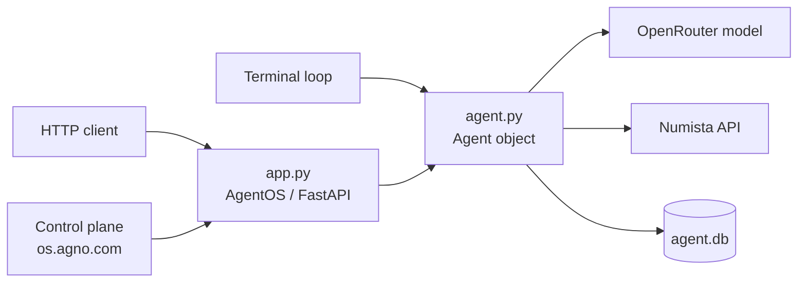

In a [previous article](https://sergiomartinrubio.com/articles/build-an-ai-agent-in-python-with-agno/) we built an _Agno_ agent that answers questions about coins by calling the [Numista](https://en.numista.com){:target="_blank"} catalogue API. It runs in a terminal loop, which is fine while you are developing and useless for anything else. A web front end cannot call it, another service cannot call it, and you cannot look at what it did yesterday.

This article puts the same agent behind an authenticated _HTTP_ API using **AgentOS**, _Agno_'s built-in server, and then connects it to a web control plane for inspecting runs. The interesting part is how little code it takes — and the two things that will waste your afternoon if nobody warns you about them.

## What AgentOS is

**AgentOS** is a [FastAPI](https://fastapi.tiangolo.com/){:target="_blank"} application that _Agno_ builds for you from a list of agents. You hand it the agent object you already have, and it generates the routes, the request validation, the _OpenAPI_ schema and the bearer-token authentication.

Because the result is an ordinary _FastAPI_ app, everything you already know applies: it runs under _Uvicorn_, you can mount your own routers onto it, and you deploy it like any other _ASGI_ application.

## The whole server

```python
from agno.os import AgentOS
from agno.os.settings import AgnoAPISettings
from dotenv import load_dotenv

from agent import agent

# Load .env before building settings, so OS_SECURITY_KEY is picked up.
load_dotenv()

agent_os = AgentOS(
    agents=[agent],
    # Reads OS_SECURITY_KEY from the environment and requires it as a
    # bearer token on every request: Authorization: Bearer <key>
    settings=AgnoAPISettings(),
)

app = agent_os.get_app()

if __name__ == "__main__":
    agent_os.serve(app="app:app")
```

That is the entire file. Note what is *not* in it: no route definitions, no request models, no authentication middleware, and — importantly — **no mention of tools, models or prompts**. All of that lives in `agent.py` and arrives through the `from agent import agent` line.

That import is the design worth copying. Both front ends, the terminal loop and the _HTTP_ server, hold a reference to the same `agent` object, so adding a tool or switching models in `agent.py` changes both at once with nothing to keep in sync.



### Gotcha one: load the environment first

```python
load_dotenv()

agent_os = AgentOS(..., settings=AgnoAPISettings())
```

`AgnoAPISettings()` reads `OS_SECURITY_KEY` **at construction time**, not on each request. If `load_dotenv()` runs after it — or not at all, because you assumed importing `agent` did it — the settings object is built with no key, and the server starts with **authentication silently disabled**. Nothing fails. Every endpoint just answers without credentials, which is the worst possible failure mode because it looks like success.

The ordering in the file above is deliberate, and the comment is there so that a later refactor does not quietly reorder the two lines.

## Protecting the endpoints

Generate a key:

```bash
python -c "import secrets; print(secrets.token_urlsafe(32))"
```

and add it to `.env` alongside the keys from the first article:

```ini
OPENROUTER_API_KEY=sk-or-v1-...
NUMISTA_API_KEY=<your Numista API key>
OS_SECURITY_KEY=<the generated string>
```

This is a shared secret, not a user system. There are no accounts and no scopes — one key grants full access to every agent in the OS. That is appropriate for a private deployment or a single trusted caller, and not appropriate for anything facing the public internet. If you need per-user access, put a real authorization layer in front of it.

## Running it

```bash
uv run app.py
```

The server listens on `http://localhost:7777`. Two endpoints are public — `/health` for liveness probes and `/docs` for the interactive _OpenAPI_ documentation — and everything else requires the bearer token:

| Endpoint | Auth | Purpose |
|---|---|---|
| `GET /health` | no | liveness check |
| `GET /docs` | no | interactive API docs |
| `GET /config` | yes | agents, models and databases in this OS |
| `GET /agents` | yes | list agents |
| `POST /agents/1/runs` | yes | run the agent (`message` form field) |

Running the agent is a `POST` to its id:

```bash
KEY=$(grep '^OS_SECURITY_KEY=' .env | cut -d= -f2-)

curl -H "Authorization: Bearer $KEY" \
     -F 'message=what is the 1925 Bulgarian 2 leva made of?' \
     http://localhost:7777/agents/1/runs
```

Two things trip people up here. The `1` in the path is the `id` you set on the `Agent(...)` object in `agent.py` — change it there and the route changes with it. And the body is **form-encoded**, not _JSON_: `-F 'message=...'`, not `-d '{"message": "..."}'`. That is why `python-multipart` is in the dependencies; without it _FastAPI_ rejects the request before your agent ever sees it.

The request takes as long as the agent needs, which for a tool-chaining question is several model round trips. Set client timeouts accordingly — a default 30-second timeout is not generous here, it is optimistic.

## The control plane

_Agno_ hosts a web UI at [os.agno.com](https://os.agno.com){:target="_blank"} for talking to your agents and inspecting their runs: the messages, the tool calls with their arguments and return values, and the token counts. It is considerably more pleasant than reading `debug_mode=True` output in a terminal.

Start your server, then add the OS with endpoint `http://localhost:7777` and paste the same value as `OS_SECURITY_KEY` into the **Security Key** field.

`localhost` working in a hosted web UI surprises people, and the reason is worth understanding: **the control plane calls your OS from your browser, not from Agno's servers.** The requests originate on your machine, so `localhost` resolves to your machine, and no tunnel or public URL is needed. Your API keys and conversation history never leave your computer.

### Gotcha two: "connected but isn't running"

If the UI reports that the OS is connected but not running while your server is plainly up, the key in the UI does not match the one in `.env`. The message describes the symptom rather than the cause, and it is almost always a stale paste or a trailing newline. Re-copy the value.

## Deploying it

`app` is a standard _ASGI_ application, so a container is the obvious route:

```dockerfile
FROM python:3.12-slim
COPY --from=ghcr.io/astral-sh/uv:latest /uv /usr/local/bin/uv
WORKDIR /app
COPY pyproject.toml uv.lock ./
RUN uv sync --frozen --no-dev
COPY . .
CMD ["uv", "run", "uvicorn", "app:app", "--host", "0.0.0.0", "--port", "7777"]
```

Before you point real traffic at it, two things in this example stop being acceptable:

- **SQLite.** `SqliteDb(db_file="agent.db")` is a file on local disk. In a container it vanishes on redeploy, and it does not survive being scaled to a second replica. _Agno_ ships _Postgres_ support, and swapping it is a one-line change in `agent.py`.
- **Sessions.** As noted in the first article, `session_id` is unset, so every run starts a new session. Over _HTTP_ this matters more than in a terminal, because it is the server's job to keep one caller's conversation separate from another's. Pass the caller's own session identifier so that two users talking at once do not read each other's history.

## Conclusion

Four lines of real code turn an agent into an authenticated _HTTP_ service, and the whole trick is the single import that keeps `agent.py` as the only place where agent behaviour is defined. The traps are not in the framework but around it: build the settings after loading the environment or you ship an open endpoint, send form fields rather than _JSON_, and move off _SQLite_ before anyone else depends on the thing.


